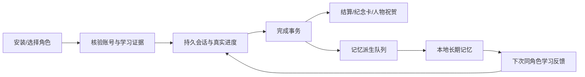

# MeMo 陪伴升级：实施蓝图与子智能体派发词

日期：2026-11-16。蓝图档位：single-blueprint（一个现有宿主、一个学习闭环）。状态：规划交付，尚未进入功能实现。

权威链：需求/总控提示词 `docs/companion-upgrade-ai-execution-prompt.md` → 本蓝图 → 接口契约 `docs/companion-upgrade-contracts.md` → `NEXT.md` 当前状态。契约只有实施主代理 P0 核对后才标记冻结；不创建平行总设计案。

## 1. 设计账本和范围

| 状态 | 内容 |
| --- | --- |
| 用户明确要求 | 长期记忆、一次安装其他角色模型、进度条与完成后人物恭喜奖励；以D_sakiko为参考；列工作区并多用子智能体 |
| 规划提案 | 本地SQLite记忆、role-pack格式、可信会话/结算、纪念卡/首次徽章、现有页面内UI；具体API/字段/上限待P0核对冻结 |
| 待查证 | 网页/API稳定用户标识映射；真实完整目标字段和提交/WS回执；真实模型/账号宿主验收 |
| 本轮不采用 | 新框架重写、全量搬入参考项目、重复迁移、合并三套学习库、自动下载大模型、商城/充值/抽卡 |

方向预算：当前为一次收束规划，核心闭环一轮已用；后续新点不自动进入实施分母。实现期持久子蓝图预算=0；出现真实失败只做一层临时问题支线，解决后回父阶段。

前端适配：recommended=lightweight-display，fit=suitable；现有设置/陪伴区/结算弹层即可承载。低能力时保留文字、备用图和真实统计；不要求独立桌宠/新WebUI。

## 2. 第一份完整可试用成果

首版同时拥有：两个完整角色追加安装与模型多选队列；本人/角色记忆跨重启及清除防复活；真实背词进度；确认完成后一次结算、纪念卡和人物祝贺；无云端/语音/动作时仍可用。

后续方向：额外连续日徽章、更多目录适配、向量检索。暂存：独立桌宠/移动端、复杂养成经济。三项核心需求不因为分阶段而推到后续方向。

## 3. 阶段、依赖和退出条件

| 阶段 | 主责与允许工作 | 退出条件与证据 |
| --- | --- | --- |
| P0 恢复基线/冻结 | M：确认D盘、原有差异、身份语义/协议夹具、契约v1、完成公式/活动会话唯一键、所有权、实际并发上限；禁止编辑日常数据 | 记录基线；新增接口/表明确标提案→冻结；目标与身份缺口有适配/unknown行为及证据计划；A/B/C收到同一契约 |
| P1 三后端并行 | A记忆、B安装、C会话/证据；M做db迁移、身份、路由、原语和桥接 | 独占模块与必要测试通过；新旧角色原语实际可调用；完整快照和幂等完成事务有失败夹具；代理交接停写 |
| P2 界面/独立验收 | D设置、E进度结算、F交叉测试；M挂载入口与持续集成 | 安装→学习→结算→重启记忆通；跨账号/换角/取消/恢复故障测试通过；无模型降级完整 |
| P3 真宿主/冻结包 | M协调F，按可用工具验证网页/桌面/实际API和模型，维护证据清单 | 新功能针对测试和现有回归通过；适用源码/EXE检查通过；真实与模拟分列，受限项明确列出 |
| P4 交付 | M更新README/CHANGELOG/验收报告/NEXT，交用户试用 | 三项功能使用方式、实际完成度、未验项、恢复办法可复核；停止自动扩建 |

P0不是新一轮无限研究。缺真实上游夹具时，按unknown分支实现本地协议与UI，安排真实确认门；缺证据的功能保持待验，不把夹具通过写作真实上游通过。

## 4. 工作区与并发调度

唯一主工作区：`D:\MeMo1`。各逻辑工作区的独占文件见总提示词第7节，临时根：`D:\MeMo1\_verification\companion-upgrade\agents`。

| 实际工具容量（含主代理） | 调度 |
| --- | --- |
| 4个槽位 | M+A/B/C第一波；交接释放后M+D/E/F第二波 |
| 7个及以上 | M+A—F可并行，UI先按冻结夹具开发，F独立读/测试 |
| 2—3个 | M保留一个槽位，优先C证据和B安装，A/D/E/F依次复用槽位 |

不要为“多代理”创建用户侧新聊天或复制模型；使用执行工具实际支持的子智能体。每次派发传入项目绝对路径、契约版本、独占文件和禁止范围。工具没有子代理时如实记录，按相同所有权串行，不虚构并行完成。

每个阶段设置共享热点编辑锁；仅M写热点。子代理提出精确插入点/最小补丁建议，M集成；独占模块交接后原代理停止写入。F发现问题回对应所有者修，避免多个代理抢修同一文件。

## 5. 所有子代理共同前缀

复制本段，并附下方对应角色任务：

> 主工程 D:\MeMo1。阅读 docs/companion-upgrade-ai-execution-prompt.md、docs/companion-upgrade-contracts.md 和本蓝图。只实现分配的独占新文件，接口依主代理冻结版本。保留原有未提交修改、所有模型与三套学习库，不改其他代理文件和共享热点，不提交/推送/发布。共享修改返回符号级插入点和补丁建议。测试使用你在 D:\MeMo1\_verification\companion-upgrade\agents\<ID> 下的临时 MEMO_DATA_DIR 与小夹具。新函数/API是真正实现后的能力，勿把提案当现成接口。交付文件、接口、迁移建议、测试命令/结果、真实未验项，并声明已停止写入以便集成。

### A：记忆服务执行提示词

> 你负责 companion_memory.py 与 tests/test_companion_memory.py。实现SQLite本地记忆、主动偏好、来源追踪、确定性摘要、关键词/近期检索、账号/角色隔离、出站开关和持久删除屏障。只消费C的已提交角色片段/outbox，不另记学习计数。覆盖重启、换衣/同名角色、删除来源、清角色/清账号、晚到AI与outbox重放、90天清理后最小来源保留。提供db迁移与两个AI入口共享上下文的接线建议。角色/账号身份取服务端适配器，codex_auth不是学习身份源。

### B：角色安装执行提示词

> 你负责 role_package_service.py、tests/test_role_packages.py、tests/fixtures/make_role_package.py。实现role-pack扫描预览、受控source_ref、稳定包→角色映射、独立registry、一层协调日志、每角色原子安装、升级/手改人设保留、取消/重启恢复和模型目录真实队列。新角色通过M提供的安装原语，旧更新接口只管已有角色。不要把Live2D模型下载当完整角色，也不要把忙时相同job当多项成功。覆盖双角色/多ZIP、部分失败、坏路径/引用/摘要、源包变化、磁盘满、中断、整包挂载互斥。只交小夹具，不下载或加载真实权重。

### C：学习会话/证据执行提示词

> 你负责 companion_sessions.py、companion_progress_sources.py、js/study-event-bridge.js，以及独立的 test_companion_sessions.py、test_companion_progress_sources.py、study-event-bridge-regression.js。实现严格完整官方快照、matched/mismatch/unknown绑定、已确认本轮增量、持久会话/角色片段、计时去重、幂等事件、目标对账和同事务结算/奖励/outbox。点击/finish/DOM消失不完成；sync_today_items哈希不是进度表。覆盖A网页/B本机账号、1000条截断、缺字段/乱序、基线已完成、同词多轮、目标归零/减小、双窗/重启/跨日、完成换角竞态和删除屏障。桥校验来源/iframe代次，真实协议不足时保留unknown，不编字段。

### D：记忆与角色设置界面执行提示词

> 你负责 js/companion-memory.js、js/role-packages.js、css/companion-settings.css、tests/companion-memory-ui-regression.js、tests/role-packages-ui-regression.js。做可用的记忆列表/来源/偏好编辑/暂停/出站授权/清除确认，以及多ZIP/多角色预览、冲突/缺项/体积、后台进度、逐项结果/重试和模型目录复选搜索队列。一次原生选择通过受控引用，不把本机绝对路径塞HTTP。目录分页/筛选后选中状态正确，不把前80项全选假称整个目录。用冻结API夹具先并行开发，再接真实服务；缺功能状态明确，产品界面不堆内部实现名词。

### E：进度与结算演出执行提示词

> 你负责 js/companion-progress.js、js/companion-settlement.js、css/companion-progress.css、css/companion-settlement.css、tests/companion-progress-regression.js、tests/companion-settlement-regression.js。做真实本轮/今日进度、未知目标/待确认状态、有效时间，以及角色形象/字幕/可用动作和可选语音的结算、纪念卡回顾和操作按钮。只读服务端结算，不自行发奖励。立即有本地祝贺，AI最多一次；缺动作/WebGL/TTS完整降级。演出票据绑定账号/角色/结算/记忆版本，换角/退出/清除废弃旧结果并停对应语音。弹层支持键盘焦点、Escape、小窗口/现有主题、减少动画；重看不自动重放。

### F：独立验收执行提示词

> 你负责 tests/test_companion_upgrade_integration.py、tests/browser/companion-upgrade.js、docs/companion-upgrade-acceptance.md。从契约独立验证学习事实→完成事务→奖励→记忆→重启恢复，以及多角色安装/切换对身份的影响；优先找重复领奖、串账号、清除后复活、半安装可见、界面只用假数据的问题。用故障注入检查提交阶段和重启恢复。区分静态、单元/集成、浏览器、真实API/模型、EXE和用户试用证据；旧迁移报告不是新功能证据。不得为了过测删除用户数据或降低验收口径。缺陷报告给M分派所有者，你不抢写业务热点。

## 6. 主代理M的额外实施任务

M统一处理：schema迁移与备份、repository适配器、身份绑定、官方限流复用、原生多选桥/受控上传、新角色安装原语、TTS/Live2D锁序、删除屏障、新API路由、两处AI共享记忆入口、学习事件桥、主题/静态白名单/资源加载/冻结打包。先交实际可调用的窄适配器给A/B/C，避免代理在虚构接口上互相等待。

回归保留原有账号、角色编辑、完整环境挂载、快捷键/输入法、语音开关和页面生命周期。index-anon.html实际为跳转入口，按实际加载链核对，不机械复制HTML。不因代理提案改公共数据格式，变更契约先版本化通知。

## 7. 证据与交付清单

建议证据根：`D:\MeMo1\_verification\companion-upgrade`。每次测试记录代码状态、命令、退出码、临时数据路径、已测/未测边界；数据与模型均为夹具时明确写出。

完整演示：安装两角色包 → 启用角色A → 匹配学习账号并设置目标 → 原生/宿主操作背词 → 真实确认完成 → 一次结算/奖励 → 重启恢复记忆 → 换角色B不冒称参与 → 清空A后旧队列不复活。目录多选、部分安装失败、缺模型/离线、双窗重复请求另演示。

结束更新 NEXT 到实际阶段并列使用方式与真实未验项。交付可运行源代码、迁移/回退说明、示例包生成器、README/CHANGELOG/必要来源声明、测试日志与验收报告；不只交任务书。一次首版交付后停在用户试用，不自行扩入后续方向。
